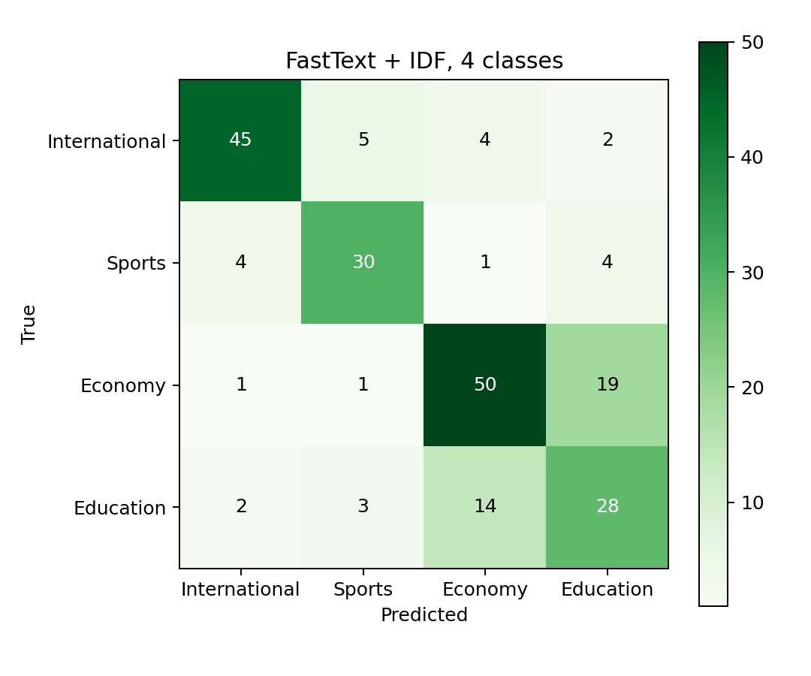

# 作业二：Gensim表示学习与FastText新闻分类

本次作业的代码、报告和实验记录见 [llm-course 仓库的 hw2 目录](https://github.com/stylke/llm-course/tree/main/hw2)。

## 1. 实验目的

这次作业我用一份独立的中文新闻标题语料训练Word2Vec和FastText，再在人民日报9801语料上做文章分类。类别从“国际、体育”两类开始，依次加入“国内经济”和“科教文卫”，观察任务变化。除了跑通分类，也做了词相似度、OOV、参数对比，并阅读论文和实现。

## 2. 数据与预处理

### 2.1 表示学习语料

外部语料选用 `649453932/Chinese-Text-Classification-Pytorch` 仓库提供的THUCNews标题子集。仓库说明它从THUCNews抽取了20万条中文新闻标题，覆盖财经、房产、股票、教育、科技、社会、时政、体育、游戏、娱乐10类。本次只使用其中的训练文件，不使用该仓库的模型或训练代码。

我从每个原始类别按文件顺序取前5000条合格标题，清理重复和过短文本后，得到50,000条标题、501,292个词。源类别只用于控制抽样数量，随后丢弃。表示学习和9801分类都使用清理后的文本。这种抽样方式比较简单，也保留了源文件顺序带来的分布特点。

标题用jieba 0.42.1分词，关闭HMM，统一全角字母数字、英文大小写，去掉纯标点，保留停用词。每条标题是一条独立训练序列，不跨标题构造上下文。下载文件为9,946,122字节，SHA256及来源记录在 [数据统计](results/data_stats.json)，复现时脚本会校验同一个文件。

选择它的理由是体积较小、格式简单、主体为新闻文本。语料只有标题，局部语境较短，年代也与9801不同。它与分类语料在年代和文本长度上都有差异。

### 2.2 9801分类数据与标签

使用项目中的 `1998-01-2003版-带音.txt`。文件为GB18030编码，原来已经分好词，没有词性后缀。我删除行首编号、`{shang5}` 一类读音标记及图片数量说明，按句末标点和 `〓` 切句，再保留含文字或数字的词。

编号中的“日期—版面—文章号”用来合并同一报道的全部段落，之后从输入中删除。同一篇文章的全部段落进入同一个集合。标题作为文章内容保留，权重与正文相同。正文沿用语料原有的分词。

原始文件有3132篇文章。我先抽查版面标题，发现同一版号在周末会变成理论、文学或图片专题。因此选取1月5—27日的工作日，按版面设置以下四个标签：

| 版面 | 本次标签 | 大致内容 |
| --- | --- | --- |
| 06 | 国际 | 国际局势、外交、海外新闻 |
| 08 | 体育 | 比赛、运动员、体育事业 |
| 02 | 国内经济 | 国内经济、市场、产业，也含部分综合新闻 |
| 05 | 科教文卫 | 科技、教育、文化、卫生等综合内容 |

这些标签根据版面编号自动生成。05版包含教育、科技、文化和卫生等内容，02版以经济报道为主，也有综合新闻。本实验用文章内容预测它所属的版面。

筛选去掉2059篇日期或版面不符合要求的文章、205篇周末文章和3篇不足20词的短文章，保留865篇。代码检查整篇完全重复，本次所选文章没有重复；未做近似转载或语义去重。分类集合按时间划分：

| 集合 | 日期 | 国际 | 体育 | 国内经济 | 科教文卫 | 总篇数 | 词数 |
| --- | --- | ---: | ---: | ---: | ---: | ---: | ---: |
| 训练 | 1月5—16日中的工作日 | 159 | 53 | 134 | 140 | 486 | 120,241 |
| 验证 | 1月19—21日 | 46 | 29 | 54 | 37 | 166 | 33,642 |
| 测试 | 1月22、23、26、27日 | 56 | 39 | 71 | 47 | 213 | 47,577 |

二分类只保留国际和体育，训练/验证/测试为212/75/95篇；三分类再加入国内经济，为346/129/166篇；四分类为486/166/213篇。所有模型使用同一份划分。按日期划分比随机切分更容易受到新闻事件变化影响，但也减少了相邻报道随机混入训练和测试的情况。

外部标题与所选9801标题检查后没有完全相同项。本次只检查了标题的完全重复，改写和转载情况未作进一步核查。

## 3. 方法与参数

### 3.1 文本表示

我比较了以下表示：

1. **TF-IDF**：Gensim词典只用9801训练集建立，保留至少出现在2篇训练文档中的词，不删除高文档频率词，最终6579维。Gensim默认使用词频乘IDF并做L2归一化，未使用scikit-learn的另一套TF-IDF默认公式。
2. **LSI**：在相同训练TF-IDF上学习100维低秩表示，转换验证、测试文档后再归一化。
3. **Word2Vec-CBOW/Skip-gram**：仅在外部标题上训练100维词向量，文章表示为已知词向量平均，OOV跳过。
4. **FastText**：使用字符子词构造100维词向量，文章表示为词向量平均。分别训练“仅外部标题”和“外部标题 + 9801训练句子”两组。
5. **FastText + IDF**：对后一组词向量按9801训练集IDF加权聚合。训练集中未见的词权重设为1，不使用验证、测试集统计。

`ft_adapted` 从头在“外部标题 + 9801训练正文”的并集上训练，共55,953条序列、621,533词。验证和测试正文只用于评测。

对词向量 \(v_w\)，普通聚合和加权聚合分别为：

$$
z_d=\frac{1}{|d|}\sum_{w\in d}v_w,\qquad
z_d^{\mathrm{IDF}}=
\frac{\sum_{w\in d}a_wv_w}{\sum_{w\in d}a_w},
\quad
a_w=\log\frac{N_{\mathrm{train}}+1}{df_{\mathrm{train}}(w)+1}+1.
$$

重复出现的词按实际次数参与聚合，随后对文档向量L2归一化。加权平均得到与词向量维度相同的稠密文档向量，词序在聚合时被忽略。

### 3.2 训练与分类设置

Word2Vec与FastText统一设置：`min_count=2`、`negative=5`、`hs=0`、`sample=0.001`、`epochs=5`、`workers=1`、种子2026。学习率从0.025降到0.0001；负采样指数显式设置0.75；默认随机缩小窗口，最大半径为5。FastText桶数50,000，主实验字符长度1—3，另比较3—6。还对领域并集模型比较50维和窗口3。

词向量分类器统一为逻辑回归，`class_weight="balanced"`，最大迭代2000次。只在训练集拟合，从 \(C\in\{0.1,1,10\}\) 中按验证Macro-F1选参数，同分取较小C，不合并验证集重新训练。由于体育训练样本较少，主要报告各类等权的Macro-F1，同时保存Accuracy和各类指标。

## 4. 表示学习观察

### 4.1 训练成本

词向量训练计时包含词表建立与训练，不含分词、模型写盘和分类评测。下表记录本机一次运行的耗时和模型大小：

| 模型 | 语料 | 维度 | 词表 | 训练秒数 | 保存模型/MiB |
| --- | --- | ---: | ---: | ---: | ---: |
| Word2Vec-CBOW | 外部标题 | 100 | 25,550 | 2.047 | 20.22 |
| Word2Vec-SG | 外部标题 | 100 | 25,550 | 6.107 | 20.22 |
| FastText 1—3 | 外部标题 | 100 | 25,550 | 9.028 | 39.29 |
| FastText 3—6 | 外部标题 | 100 | 25,550 | 7.658 | 39.29 |
| FastText 1—3 | 外部+训练正文 | 100 | 29,027 | 11.734 | 42.04 |
| FastText 1—3 | 外部+训练正文 | 50 | 29,027 | 8.967 | 21.43 |

FastText多保存了一张子词桶矩阵，因此相同维度比Word2Vec大。维度减半明显减少文件大小；时间没有同比减半，因为分词索引、采样、窗口等开销仍存在。TF-IDF建立和转换约0.211秒，LSI学习和转换约0.234秒。这两种方法拟合的是486篇9801训练文章，词向量模型使用的是50,000条外部标题，处理的数据规模不同。

### 4.2 词相似度、类比与OOV

领域并集FastText的部分余弦相似度如下：

| 词对 | 余弦 |
| --- | ---: |
| 足球—篮球 | 0.9468 |
| 银行—金融 | 0.7696 |
| 学校—教育 | 0.8027 |
| 足球—银行 | 0.3547 |

“银行”的最近邻包括渣打银行、外资银行、工商银行、工行、兴业银行；“足球”的前五邻居为足球队、足协杯、篮球、足球场、虾球。前几项符合领域关联，“虾球”则体现了单字共享带来的字形偏差。这里的相似度同时受语境和字形影响。

按课件第132—134页，我还调用了多词相似度与向量类比。`美国 + 北京 - 中国` 的前列是美加州、北京晚报、美院等词，与预期的美国首都相差较大。这次类比没有成功，短语料、年代、字形共享和训练轮数都可能影响结果。

测试集47,577词中，外部Word2Vec词表覆盖40,774词，即85.70%，余下词跳过。FastText通过子词组合为全部测试词返回向量；加入训练正文后，完整词表覆盖43,709词，即91.87%。

我预设了三个确认不在词表中的复合词。Word2Vec全部无法查到，FastText都能组合子词：

| OOV词 | FastText前三近邻 |
| --- | --- |
| 互联网助学平台 | 互联网络、互联网服务、实用主义 |
| 智能农业机器人 | 人工智能、农机具、零配件 |
| 量子足球俱乐部 | 辛亥革命、黑手党、范甘迪 |

前两项的近邻有一定关联，最后一项的近邻偏离了词语本身的含义。这三个自拟复合词用来观察OOV向量的生成结果。全部原始相似词和得分见 [词向量探针](results/semantic_probes.json)。

## 5. 新闻分类结果

### 5.1 主实验

下表为测试Macro-F1；每个模型和任务的C都先由验证集选定：

| 表示 | 二分类 | 三分类 | 四分类 |
| --- | ---: | ---: | ---: |
| TF-IDF | 0.9329 | 0.9213 | **0.8599** |
| LSI 100维 | **0.9781** | 0.9171 | 0.8447 |
| Word2Vec-CBOW | 0.7409 | 0.6861 | 0.5357 |
| Word2Vec-SG | 0.8301 | 0.7645 | 0.6907 |
| FastText，仅外部标题 | 0.8513 | 0.8241 | 0.7094 |
| FastText，外部+训练正文 | 0.8506 | 0.8272 | 0.7117 |
| FastText，外部+训练正文，IDF聚合 | 0.8713 | 0.8578 | 0.7192 |

`selection.json` 在Gensim管线中按验证Macro-F1选二分类的字符3—6 FastText、三分类TF-IDF、四分类TF-IDF。二分类FastText验证F1为0.98603，LSI为0.98591，差距很小；验证选择的FastText测试F1为0.8518，反而低于LSI的0.9781，体现了小验证集选型的不稳定。四分类TF-IDF的验证Macro-F1为0.9068，C=0.1，测试Accuracy为0.8545；FastText+IDF的验证Macro-F1为0.8209，C=1，测试Accuracy为0.7183。

这次稀疏TF-IDF明显强于平均词向量。我的理解是，文章主题中有很直接的关键词，TF-IDF保留了各词的独立权重；将整篇正文压成100维平均向量会混合这些信息。而词向量训练主要来自跨年代的短标题，未必适合9801正文。

本次SG比CBOW好，FastText相对外部SG也有所改善。加入训练正文后，三、四分类的改善较小，二分类的分数略有下降。IDF加权比简单平均更有帮助，整体仍低于TF-IDF。

随着类别增加，任务中加入了经济、科教文卫的交叉内容，样本数量和构成也随之变化，分类难度逐渐增加。

### 5.2 参数对比与随机种子

四分类参数对照如下。除了标出的变量，FastText和分类过程沿用前述设置：

| 配置 | 验证Macro-F1 | 测试Macro-F1 |
| --- | ---: | ---: |
| 外部标题，字符1—3，100维 | 0.8015 | 0.7094 |
| 外部标题，字符3—6，100维 | 0.7873 | 0.6881 |
| 外部+训练正文，100维，窗口5 | 0.8204 | 0.7117 |
| 外部+训练正文，50维，窗口5 | 0.8198 | 0.7232 |
| 外部+训练正文，100维，窗口3 | 0.8059 | 0.7053 |
| 外部+训练正文，100维，IDF聚合 | 0.8209 | 0.7192 |

1—3字符的四分类分数高于3—6，二分类中两者接近。50维的测试F1略高于100维，验证F1略低，两种维度的结果相近。窗口3的分数低于窗口5。

对领域并集、100维、普通平均四分类，另外跑了种子7和42，测试Macro-F1分别为0.7270和0.7069；种子2026为0.7117。三次均值0.7152、样本标准差0.0105。这个配置随随机种子有约一个百分点的波动，其他模型只运行了种子2026。

### 5.3 官方fastText监督分类

官方fastText 0.9.3只用9801训练文章，表示和分类器联合学习。维度100、25轮、单线程、字符子词关闭，类别数少所以使用普通softmax。分别比较词unigram和连续词bigram，从学习率0.1、0.5按验证Macro-F1选择；各任务这次均选0.5。

| 输入特征 | 二分类测试F1 | 三分类测试F1 | 四分类测试F1 | 四分类Accuracy |
| --- | ---: | ---: | ---: | ---: |
| 词unigram | 0.9213 | 0.9069 | 0.7623 | 0.7887 |
| unigram+bigram | 0.8732 | 0.8706 | 0.6823 | 0.7136 |

unigram四分类强于固定平均词向量，仍低于TF-IDF。bigram没有带来改善，可能与训练文章少、组合稀疏和哈希桶较小有关。两组分类器的训练设置也有差别：主实验逻辑回归使用类别均衡权重，官方fastText使用原始类别分布。

官方模型参数、验证过程和完整预测见 [监督分类记录](results/supervised_metrics.json)。

## 6. 错误分析与源码对应

FastText+IDF四分类混淆矩阵如下，行是真实版面，列是预测：

| 真实\预测 | 国际 | 体育 | 国内经济 | 科教文卫 |
| --- | ---: | ---: | ---: | ---: |
| 国际 | 45 | 5 | 4 | 2 |
| 体育 | 4 | 30 | 1 | 4 |
| 国内经济 | 1 | 1 | 50 | 19 |
| 科教文卫 | 2 | 3 | 14 | 28 |

213篇中错60篇，经济与科教文卫互判共33篇。TF-IDF错31篇，这两个方向也占21篇。按日期顺序保留的错误样例包括：“出版产业造『大船』”在科教文卫版却有企业、产业内容；“华为同步设备填补国内一项空白”也属于科教文卫版，但被预测为经济。两个版面的内容存在交叉，模型较容易混淆。上述预测都以整篇文章为输入。

源码方面，我沿着Gensim的 `build_vocab → train → _do_train_job → train_batch_any` 看到了以下对应：

- CBOW聚合上下文预测中心词；SG以中心词预测上下文。底层直接索引参数矩阵中对应的行。
- 负采样循环用 `g=(label-sigmoid(score))*alpha` 更新输入和输出向量，sigmoid采用查表近似；负例抽中正上下文时会跳过。
- FastText对加了词首词尾标记的字符n-gram做FNV-1a哈希，完整词向量和子词向量一起更新。最终查向量与OOV组合的路径不同。
- `window`默认随机缩小；`sample`控制高频词下采样；`workers`与任务队列影响更新顺序。
- 监督式fastText的 `dictionary.cc` 构造连续词n-gram，`model.cc` 平均输入特征后预测类别；Gensim的子词则从词内部的字符片段生成。

实际统计领域模型有93,802种不同子词字符串，映射到42,265个已占用桶，说明多个字符串共享同一桶。固定桶数节省了内存，也带来了哈希冲突。本次桶数设为50,000，没有进一步比较其他桶数。

论文与本次实现有几处差别：Bojanowski等论文实验采用词频平方根负采样，Gensim本次使用0.75指数；论文用求和描述子词表示，Gensim训练及最终取向量时还进行了缩放。更详细的调用链、公式和参数意义在 [源码阅读笔记](源码阅读笔记.md)。

## 7. 检查与体会

我做了8项回归测试，覆盖读音和全角清理、带空格的图片说明、句界、文章划分、预处理一致性、OOV及零向量处理。另由保存的逐篇预测复算全部36张分类结果表，检查混淆矩阵、模型数组有限性和加载后预测一致，结果均通过。记录见 [分析结果](results/analysis.json) 与 [日志](results/logs/)。

这次实验让我看到了几种文本表示的差别。FastText能够通过子词生成未登录词向量，平均聚合则会丢失词序、混合关键词信息。TF-IDF保留了词的独立权重，在这份分类任务上表现较好。检查版面标题也帮助我确定了标签范围，并解释了经济与科教文卫之间较多的误分类。

本次分类训练样本较少，标签较粗，使用了一个时间切分，外部表示学习语料只有短标题。后续可以逐篇标注一部分文章，加入同年代的外部新闻正文，再比较更大的哈希桶和其他向量聚合方法。

## 参考资料

1. 课程 `2026-秋季-大语言模型与应用实践-L2.part1.pptx`，第123—137、143—149、154—170页。
2. 项目提供的人民日报1998年1月带音分词语料。
3. THUCNews及新闻标题子集来源：`https://thuctc.thunlp.org/`；`https://github.com/649453932/Chinese-Text-Classification-Pytorch`。
4. Gensim文档与4.3.3实现：`https://radimrehurek.com/gensim/`；`https://github.com/piskvorky/gensim/tree/4.3.3`。
5. Mikolov等，*Efficient Estimation of Word Representations in Vector Space*，2013，arXiv:1301.3781；*Distributed Representations of Words and Phrases and their Compositionality*，2013，arXiv:1310.4546。
6. Bojanowski等，*Enriching Word Vectors with Subword Information*，TACL 2017，arXiv:1607.04606。
7. Joulin等，*Bag of Tricks for Efficient Text Classification*，EACL 2017，arXiv:1607.01759；官方fastText 0.9.3源码包。

代码、数据处理结果、训练模型及报告均位于 `hw2/`。复现命令和文件说明见 [README](README.md)。
