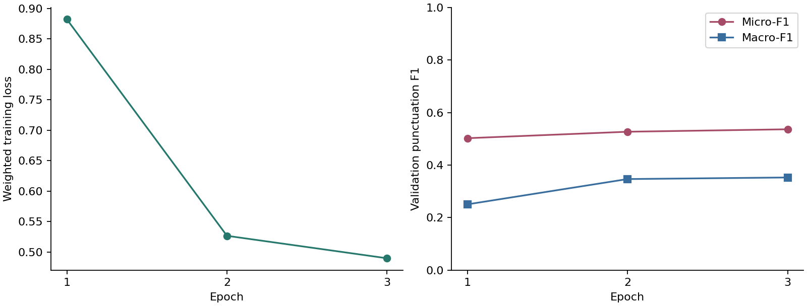
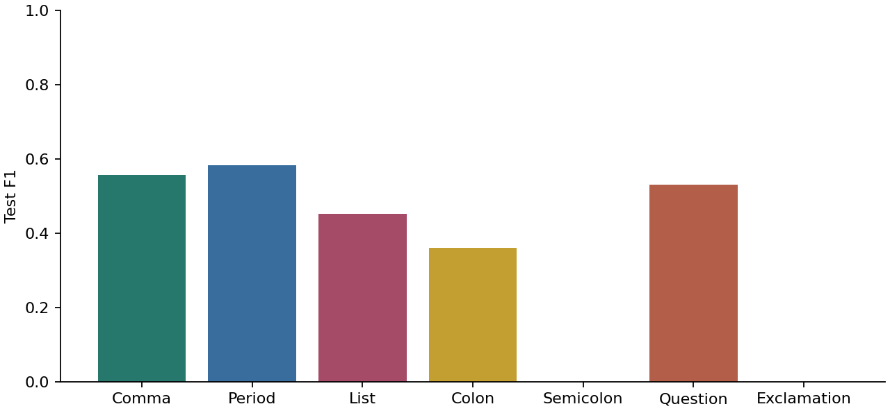
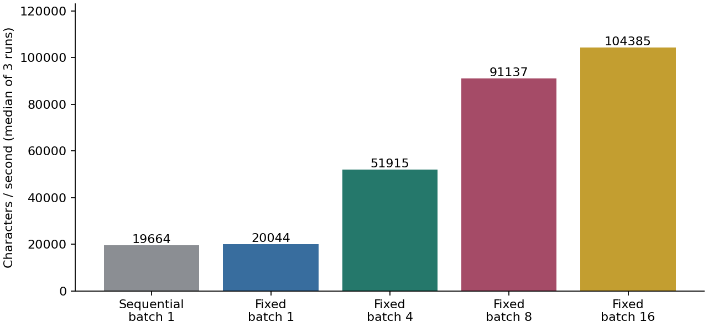

# 作业三：BERT微调与批量滑窗标点恢复

本次作业的代码、报告和实验记录见 [llm-course 仓库的 hw3 目录](https://github.com/stylke/llm-course/tree/main/hw3)。

## 1. 实验内容

这次作业对应课件 `2026-秋季-大语言模型与应用实践-L2-part2.pptx` 第68页。我用预训练中文BERT模型在人民日报9801语料上微调，学习给去掉标点的文本恢复标点。长文章采用滑窗输入，比较课件中的顺序处理方法与批量处理方法。

实际完成了数据制备、3轮微调、验证选型、测试集评测和速度实验。训练使用现代新闻文本，古文另取两段作示例观察。

## 2. 数据制备

### 2.1 从分词语料生成字符标签

使用项目提供的 `人民日报语料/1998-上半年-带音/1998-01-2003版-带音.txt`，按GB18030严格解码。原文件有3132篇文章、23,258行，约5.32MB。文件SHA256及处理统计保存在 [data_stats.json](results/data_stats.json)。

行首的日期、版面、文章号和段落号用于合并文章和排序段落，随后从正文删除。清理读音标记、图片数量说明和分词空格，使用NFKC统一全角字母数字。保留汉字、字母、数字、百分号、中点，以及数字内部的小数点和连字符。

每个字符的标签表示它后面的标点，设为八类：

| 标签 | 含义 |
| --- | --- |
| O | 后面没有标点 |
| ， | 逗号 |
| 。 | 句号 |
| 、 | 顿号 |
| ： | 冒号 |
| ； | 分号 |
| ？ | 问号 |
| ！ | 叹号 |

例如“我读书，随后写笔记。”生成输入“我读书随后写笔记”，在“书”后标逗号、“记”后标句号。原有标点只用于生成标签，模型输入中已删除这些标点。

引号、括号、书名号、破折号和省略号在本次预处理中删除；数字内部的小数点作为正文保留。连续出现多个目标标点时保留一个，句末标点优先。这份输出恢复七类标点，正文中被删除的排版符号没有对应标签。

我筛掉没有句号、问号或叹号的段落，以及不足20字或没有有效标点标签的段落，主要去除标题、署名和部分图片说明。筛选后有3027篇文章。这个规则比较简单，带完整句子的图片说明仍可能保留，正文中的无句末标点短行也会被筛掉。

### 2.2 按文章和日期划分

| 集合 | 日期 | 文章数 | 段落数 | 训练/评测片段数 | 字符数 |
| --- | --- | ---: | ---: | ---: | ---: |
| 训练 | 1月1—20日 | 1947 | 8292 | 8937 | 1,016,810 |
| 验证 | 1月21—24日 | 527 | 2237 | 2401 | 272,106 |
| 测试 | 1月25—31日 | 553 | 2430 | 2574 | 279,140 |

同一篇文章的全部段落进入同一个集合。训练和片段评测按段落切成最多256字的片段，切分位置直接沿用原有字符标签。片段末尾保留其真实标签，未统一改成句号。整篇评测则拼接筛选后的各段正文，不向模型提供原段落边界。

训练集中O类有928,485个，占91.31%。逗号、句号、顿号分别有47,844、23,094、13,064个，问号和叹号只有461、399个。类别分布较不均衡，因此训练使用类别加权交叉熵，评测同时观察总体和逐类分数。

## 3. 模型微调

### 3.1 预训练模型和标签对齐

模型选用 `uer/chinese_roberta_L-4_H-256`，固定版本为 `68d674689f3c9d425e5436149c8acece077187f1`。它使用BERT编码器架构，有4层、256维隐藏表示、4个注意力头、21,128个词表项，最大位置长度为512。模型卡介绍它使用CLUECorpusSmall及MLM进行预训练。本次加载现成权重，新增逐位置分类层，对编码器和分类层一起微调。

我选这个小模型是为了在本机M4、16GB内存环境下跑完训练和多组解码实验。微调模型有8,701,960个参数，保存文件约33.73MiB。它与课件中的12层BERT-BASE在规模上有差别，沿用相同的序列标注接口和512位置限制。

参考课件第61、65页，把每个原始字符作为一个输入单元，再调用同一套fast tokenizer。通过 `word_ids()` 找到每个字符对应的首个子词，标签放到该位置。其余子词、`[CLS]`、`[SEP]`和padding的标签设为 `-100`，在损失计算中忽略；`attention_mask` 同时屏蔽padding。

这种对齐方式覆盖了汉字、英文和数字。推理后按原始字符位置取回分类结果，使用原文字符重建输出，生僻字即使编码成 `[UNK]` 也保留其原字形。代码会检查字符对齐数量和实际token长度，窗口超过512个token时报告错误。

### 3.2 训练设置

| 参数 | 本次设置 |
| --- | --- |
| 微调范围 | 全部编码器和分类层 |
| 训练轮数 | 3 |
| batch size | 32 |
| 最大片段 | 256字，加特殊token |
| 优化器 | AdamW |
| 学习率 | 5e-5 |
| 权重衰减 | 0.01 |
| 学习率调度 | 10% warmup，随后线性下降 |
| 梯度裁剪 | 1.0 |
| 随机种子 | 2026 |
| 设备和精度 | Apple M4，PyTorch MPS，float32 |

类别权重按训练频次计算 \(w_c=\min(8,\sqrt{n_O/n_c})\)，再除以所有权重的均值。上限8使低频类别的权重保持在较小范围。代码单独计算加权交叉熵，模型输出头保留Transformers原有实现。

| 轮次 | 平均训练损失 | 验证标点Micro-F1 | 验证标点Macro-F1 |
| --- | ---: | ---: | ---: |
| 1 | 0.8821 | 0.5023 | 0.2506 |
| 2 | 0.5268 | 0.5269 | 0.3468 |
| 3 | 0.4899 | 0.5362 | 0.3528 |

3轮训练连同逐轮验证和保存模型共178.99秒，最佳模型为第三轮。训练前后第一层query矩阵的最大绝对变化为0.00749，检查结果显示编码器参数已经更新。这里的计时从完成模型初始化后开始，不含下载和数据编码。

类别加权后，原始输出预测的标点偏多。我在验证片段上尝试给O类logit加0、0.5、1.0、1.5、2.0的偏置，标点Micro-F1分别为0.5362、0.5551、0.5661、0.5606、0.5326，选出1.0。后续推理使用该偏置；选择记录见 [calibration.json](results/calibration.json)。

## 4. 长文批量滑窗

### 4.1 顺序处理方法

按课件第68页实现：每次输入最多400字，对前300字寻找最后一个预测句号，在该位置结束本次输出，下一次从这个位置继续。前300字没有预测句号时直接前进300字。到达文章末尾时输出余下全部字符。

下一窗口的起点依赖当前预测，因而同一篇文章的窗口依次运行。起点退回句号还会增加重复处理的字符数量。

### 4.2 固定切窗与批量融合

我的批量方法分三步：

1. 根据文本长度提前生成窗口：`[0,400)`、`[300,700)`、`[600,1000)`等，最后一窗覆盖文末。每窗最多400字，相邻窗重叠100字，所有起点由字符偏移决定。
2. 把同一文章和其他文章的窗口放进同一队列，按长度分组后组成batch。每个batch动态padding到组内最长序列，一次前向计算返回多个窗口的逐字符概率。
3. 按“文章编号、起点、终点”把概率写回原字符位置，重叠区域融合后取最大概率类别，最后按字符顺序插入标点。

窗口内部位置 \(j\) 的中心权重为：

$$
w_j=\min(j+1,L-j,51),\qquad
p_i(c)=\frac{\sum_{k:i\in W_k}w_{ki}p_{ki}(c)}
{\sum_{k:i\in W_k}w_{ki}}.
$$

窗口边缘的上下文较少，给它较小的权重。实现累加概率的加权和后直接取argmax，同一位置的分母对所有类别相同。累计权重也用来检查每个字符是否被窗口覆盖。

我在整篇验证文章上比较了普通平均和中心加权，标点Micro-F1为0.5325和0.5336，选中心加权。选择结果保存在 [merge_selection.json](results/merge_selection.json)。两者差距较小。

以400字窗口、300字步长处理很长的文章，重复编码的字符数约为原长度的 \(400/300\) 倍。窗口提前确定后，模型调用次数约为窗口数除以batch size，原来的逐次依赖也随之消除。

代码使用 `torch.inference_mode()`，解码时关闭dropout。输入窗口无需原标点和原段落边界。输出拼接依据字符索引完成，每个字符只写入一次，重叠区在概率层面融合。

## 5. 标点恢复结果

### 5.1 全部测试文章

测试集共553篇、279,140字，恢复整篇文章的七类标点。标点Micro-F1计算标点类别的精确匹配；Macro-F1对七种标点等权平均；边界F1只判断该位置是否存在标点，忽略具体类型。

| 方法 | 字符Accuracy | 标点Micro-F1 | 标点Macro-F1 | 边界F1 |
| --- | ---: | ---: | ---: | ---: |
| 全部预测O | 0.9115 | 0.0000 | 0.0000 | 0.0000 |
| 字符多数标签基线 | 0.9120 | 0.0332 | 0.0859 | 0.0490 |
| 微调BERT，批量重叠滑窗 | 0.9329 | 0.5380 | 0.3545 | 0.6980 |

字符多数标签基线只统计训练集中每个字符后面最常出现的标签，未使用上下文。由于O类占多数，全部预测O也有较高Accuracy；标点F1更直接地反映了本次任务效果。

BERT标点Precision为0.5423、Recall为0.5339。逐类结果如下：

| 标点 | 测试数量 | Precision | Recall | F1 |
| --- | ---: | ---: | ---: | ---: |
| ， | 13,243 | 0.5568 | 0.5563 | 0.5565 |
| 。 | 6305 | 0.5471 | 0.6232 | 0.5827 |
| 、 | 3945 | 0.4769 | 0.4294 | 0.4519 |
| ： | 519 | 0.5321 | 0.2717 | 0.3597 |
| ； | 468 | 0.0000 | 0.0000 | 0.0000 |
| ？ | 115 | 0.6420 | 0.4522 | 0.5306 |
| ！ | 99 | 0.0000 | 0.0000 | 0.0000 |

逗号、句号有较多训练样本，结果较好。分号和叹号在最终整篇测试中没有被预测出来，这两个标签的训练频次低，当前权重和3轮微调下仍没有学好。问号虽然也较少，问句的局部表达提供了一些线索。

训练脚本还保留了按256字片段计算的未校准测试分数，Micro-F1为0.5421。该评测保留原段落分隔，而整篇测试去掉段落边界并使用400字重叠窗，两组的上下文和偏置条件都有差别。

全部文章预测见 [test_predictions.jsonl](results/test_predictions.jsonl)，完整指标和混淆矩阵见 [test_metrics.json](results/test_metrics.json)。一次batch 8整篇测试运行耗时4.60秒，包含分词、输入传输、模型计算和概率拼接，不含模型加载。

### 5.2 错误和古文示例

按文章顺序保存前12个错误样例。第一篇中“编者按：”被预测成“编者按”，省掉了冒号；报道中的长职务列表容易混淆逗号与顿号，也会在姓名附近错误插入句号。实际混淆矩阵中，有1470个真实逗号被预测成句号、1048个真实句号被预测成逗号。

现代文自拟例子的输出为：

> 全国人民代表大会常务委员会今天举行会议审议有关法律草案与会人员认真讨论，提出修改意见。会议决定将草案提交下一次会议继续审议。

模型在“修改意见”后恢复了句号，在“法律草案”后漏掉了句号。部分长句的主谓连接和句间边界仍有混淆。

《论语》示例输出为：

> 学而时，习之不亦说，乎，有朋自远方来，不亦乐乎人，不知而不愠不亦君子乎。

《岳阳楼记》示例中也出现了“滕子、京”“增，其旧制刻。”等错误。现代新闻训练得到的模型对这两段古文恢复较差，古文的词语、句法和语气词与训练文本存在明显差异。古文例子只作人工观察，未纳入新闻测试分数。原输入和原样输出见 [demo.json](results/demo.json)，错误样例见 [error_samples.json](results/error_samples.json)。

## 6. 解码效率对比

从测试文章中按原顺序选取长度至少1500字的文章，预设上限24篇，实际符合条件的有23篇。总长54,129字，单篇1509—5224字。文章编号和每次耗时保存在 [benchmark.json](results/benchmark.json)。

使用同一个模型、O类偏置和MPS设备。每个配置先预热，随后重复3次，GPU同步后计时，报告中位数。计时包含窗口预测和拼接，不含权重加载；固定方法的窗口规划、长度排序在计时前完成。

| 方法 | batch | 模型调用次数 | 重复计入的处理字数 | 耗时/秒 | 吞吐/字每秒 | 相对顺序方法 |
| --- | ---: | ---: | ---: | ---: | ---: | ---: |
| 预测句号移动起点 | 1 | 207 | 79,913 | 2.753 | 19,664 | 1.00 |
| 固定重叠滑窗 | 1 | 184 | 70,229 | 2.700 | 20,044 | 1.02 |
| 固定重叠滑窗 | 4 | 46 | 70,229 | 1.043 | 51,915 | 2.64 |
| 固定重叠滑窗 | 8 | 23 | 70,229 | 0.594 | 91,137 | 4.63 |
| 固定重叠滑窗 | 16 | 12 | 70,229 | 0.519 | 104,385 | 5.31 |

固定切窗减少了处理字符数，但batch 1与顺序方法的耗时接近。把窗口成批送入模型后，调用次数明显减少，batch 16达到顺序方法的5.31倍吞吐量。batch 8到16仍有提升，幅度小于batch 1到8。

这23篇长文章上，顺序方法的标点Micro-F1为0.5364，固定方法为0.5310。两种切窗和拼接策略的上下文不同，存在约0.0054的分数差。固定方法在batch 1、4、8、16下的54,129个字符标签全部一致，批量大小改变了速度，未改变这次预测。

本次计时来自小模型和Apple MPS，不同模型规模、GPU后端和机器负载会改变吞吐量。使用CUDA机器时，同一套代码会选择CUDA设备，batch大小可按显存调整。
